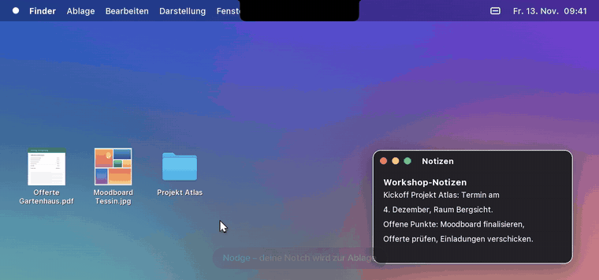
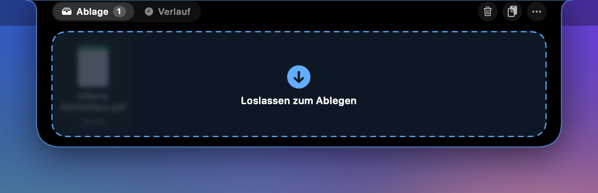
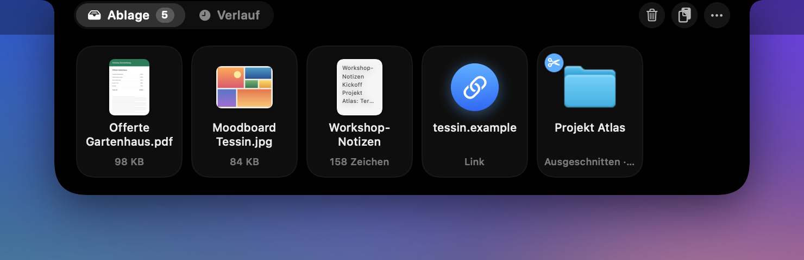
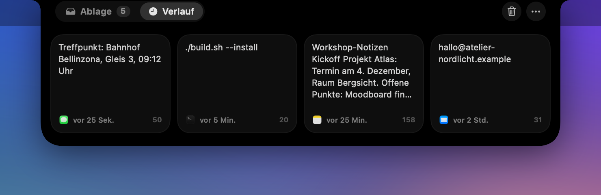
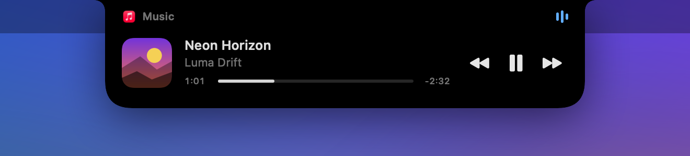

<div align="center">


# Nodge

**A Dynamic Island for the MacBook notch.**
Shelf for files, images, text and links · Clipboard history · Now Playing




<sub>Demo with fictional files and songs · <a href="docs/demo.mp4">Full-resolution video (MP4)</a></sub>

</div>

---

## What is Nodge?

Nodge turns the camera notch into a small, always-available stash that never gets in your way.
Drag something onto the notch and it stays there until you need it again, across apps, Spaces and restarts.
Move the mouse up and the island opens; move away and it closes again.

Nodge is a native SwiftUI/AppKit app: no Electron, no background polling, and practically 0 % CPU while closed.

> The app's interface is currently in German.

## Features

<table>
<tr>
<td width="50%" valign="top">

### 🗂️ Shelf
Drag files, folders, images, text and links onto the notch.
The island notices while you are still dragging and shows a drop target.
Everything is kept until you take it out again.

</td>
<td width="50%" valign="top">



</td>
</tr>
<tr>
<td valign="top">



</td>
<td valign="top">

### 🃏 Cards
- **Click**: copy to the clipboard
- **Double-click**: open (text in TextEdit, links in the browser)
- **Drag out**: drop into Finder, Mail, the browser …
- **Right-click**: more actions
- **Paste button**: add the current clipboard content to the shelf

</td>
</tr>
<tr>
<td valign="top">

### 🕘 History
Everything you copy with <kbd>⌘</kbd><kbd>C</kbd> shows up automatically in the history tab, along with the source app and time.
Content from password managers is never stored.

</td>
<td valign="top">



</td>
</tr>
<tr>
<td valign="top">



</td>
<td valign="top">

### 🎵 Now Playing
When music or video is playing (Music, Spotify, the browser …), the notch shows an equalizer and the app's icon.
Hover just right of the notch for cover art, title, play/pause, next, previous and scrubbing.

</td>
</tr>
</table>

### ⌨️ Keyboard shortcuts

| Shortcut | What it does |
|---|---|
| <kbd>⌘</kbd><kbd>⇧</kbd><kbd>Space</kbd> | **Drop selection**: the selected files in Finder, otherwise the selected text |
| <kbd>⌘</kbd><kbd>⇧</kbd><kbd>↑</kbd> | **Cut** (in Finder): the file stays where it is until you drag it out of the island somewhere else, then it is moved ✂️ |

### ⚙️ Settings

From the island's ••• menu or the menu bar icon:
Record clipboard · Show Now Playing · Launch at login · Show shelf folder in Finder · Clear shelf or history
(or use the trash button in the top right: click twice).

## At a glance

| Action | What happens |
|---|---|
| Move the mouse onto the notch | The island opens and closes again when you move away |
| Drag a file, text or image onto the notch | The notch shows a drop target, opens, release to drop |
| Click / double-click a card | Copy / open |
| Drag a card out | Drop into Finder, Mail, the browser … |
| History tab | Everything copied with ⌘C |
| Hover just right of the notch | Now Playing with playback controls |

Also works on Macs **without** a notch: the island then sits at the top center of the screen.

## Installation

Requirements: **macOS 13 (Ventura) or later** and the Xcode Command Line Tools (`xcode-select --install`). Xcode itself is not needed.

```bash
git clone https://github.com/joaquin4053/Nodge.git
cd Nodge
./build.sh --install
```

A tray icon then appears in the menu bar, and Nodge is running.

```bash
./build.sh            # builds build/Nodge.app (universal: Apple silicon + Intel)
./build.sh --run      # build and launch
./build.sh --install  # copy to /Applications and launch (required for "Launch at login")
./build.sh --share    # ~/Desktop/Nodge.zip for sharing (app + instructions)
```

### First launch

The app is only ad-hoc signed and not notarized. On first launch, allow it once under
**System Settings → Privacy & Security → "Open Anyway"**.

The first time you use a keyboard shortcut, macOS may ask for:
- "Nodge wants to control Finder" → OK
- **Accessibility** → enable Nodge in System Settings, then press the shortcut again

## Data & privacy

- Everything stays local in `~/Library/Application Support/Nodge/`; nothing leaves your Mac.
- Dropped files are copied as APFS clones: instantly and without using extra disk space.
- The history keeps at most 60 entries and ignores content marked as confidential (e.g. from 1Password).
- Clipboard recording and Now Playing can be switched off at any time.

## Project structure

```
Sources/Nodge/
├── main.swift               app startup, menu bar icon
├── NotchController.swift    window above the notch, hover, open/close
├── NotchViewModel.swift     island state and sizes
├── ShelfStore.swift         shelf (files, text, links), persistence, drag & drop
├── ClipboardHistory.swift   clipboard history
├── NowPlaying.swift         Now Playing (via Helper/NowPlayingHelper.m)
├── QuickDrop.swift          ⌘⇧Space and ⌘⇧↑ shortcuts
├── Snapshot.swift           offscreen rendering for tests and the demo
└── Views/                   SwiftUI interface (island, cards, history, media)
Helper/                      Now Playing helper (runs inside the system perl)
Resources/                   Info.plist, app icon, Anleitung.txt (German user guide)
tools/make_demo.py           generates the demo video and screenshots in this README
```

## Development

The app is built directly with `swiftc` (SwiftPM sometimes needs full Xcode when only the Command Line Tools are installed).

**Check UI states without screen-recording permission:**

```bash
NODGE_SNAPSHOT=/path build/Nodge.app/Contents/MacOS/Nodge
```

renders every island state as a PNG and exits.

**Regenerate the demo video and screenshots** (requires Python 3 with Pillow, and ffmpeg):

```bash
./build.sh
python3 tools/make_demo.py   # → docs/demo.mp4, docs/demo.gif, docs/screenshot-*.png
```

The script creates fictional sample files, has Nodge render each state offscreen
(`NODGE_DEMO`), and composites the desktop, mouse pointer, captions and transitions.
All files, texts and songs in the demo are made up.
